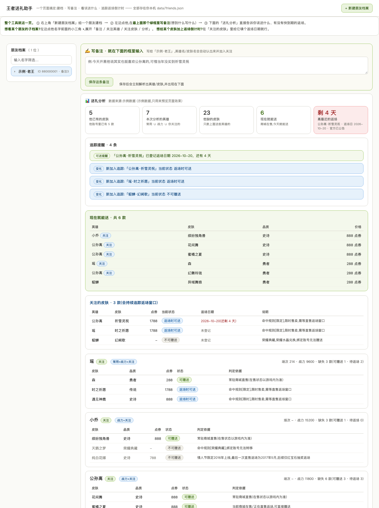
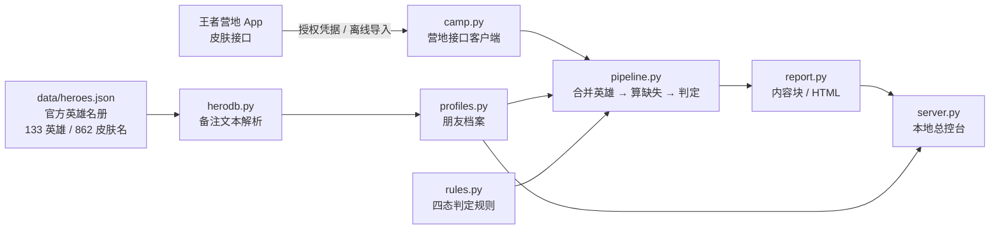
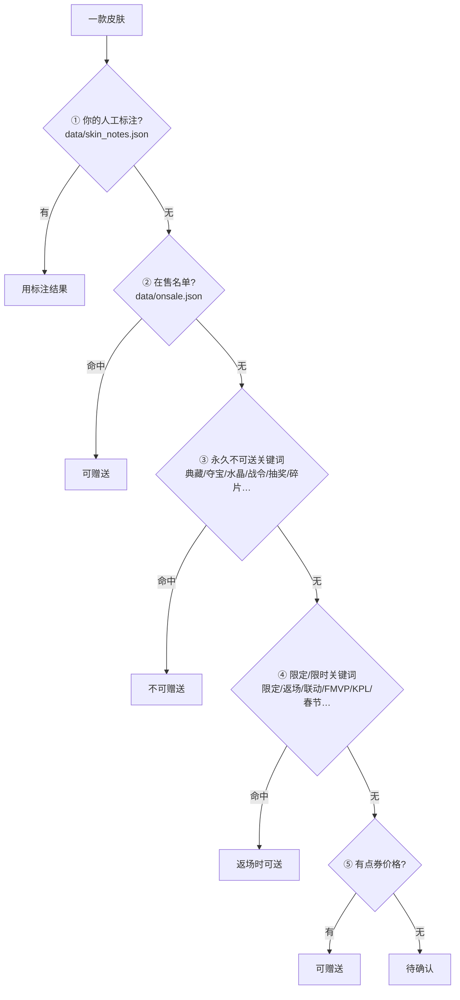

<div align="center">

# 王者送礼助手 · wzry-gift-tool

**给每个朋友单独建档 — 自动算出「送哪款皮肤、现在能不能送」，并持续盯着返场窗口，窗口一开就提醒你。**

**v0.5.0** · Python 3.8+ · 零第三方依赖 · 纯本地运行，数据不出你的电脑

</div>

---

## 它解决什么问题

想给游戏好友送皮肤，正常流程是：**翻他的常用英雄 → 一个个点开看缺哪款 → 再去商城确认那款还在不在卖 → 还要判断它到底能不能赠送**。
一个朋友十分钟，十个朋友就是一小时，而且皮肤的"能不能送"会随时间变——**限定皮肤只在返场窗口内可赠送**，窗口一开一关，人肉盯着商城必然错过。

这个工具把整条链路自动化，并且**以"朋友"为单位归档**，让一次性查询变成长期跟踪：

| 它替你做的事 | 具体表现 |
|---|---|
| 算该送什么 | 他的 **常用英雄 ∪ 战力英雄 ∪ 你关注/备注过的英雄** → 每款缺失皮肤 → 按赠送规则定态 |
| 判断能不能送 | **四态**：可赠送 / 返场时可送 / 不可赠送 / 待确认，每条都给出判定依据 |
| 记住你们的聊天 | 写一句"他说很喜欢公孙离"，**自动识别英雄与皮肤名**并加入筛选 |
| 盯着返场窗口 | 关注皮肤 + 登记返场日期 → 顶部**倒计时**（≤7 天变红），状态一变就出提醒 |

## 界面

一个页面搞定所有事，不用在多个文件之间跳：

- **左侧**：朋友列表，点名字前的 `▸` 展开子档案（备注 / 关注英雄 / 关注皮肤 / 送礼分析）
- **右侧顶部**：**✍️ 写备注** 输入框 —— 想到什么写什么，保存后立刻显示识别出的英雄与皮肤
- **右侧主体**：这份档案的 **📊 送礼分析**（五张卡片 + 追踪提醒 + 现在就能送清单 + 每个英雄的皮肤明细）



```bash
python3 -m gifttool serve     # 浏览器自动打开 http://127.0.0.1:8765
```

## 顶部五张卡片

前三张是**情况**，后两张是**结论**：

| 卡片 | 含义 |
|---|---|
| 他已有的皮肤 | 对方账号里已拥有的皮肤款数 |
| 本次分析的英雄 | 参与分析的英雄个数 = 常用 ∪ 战力 ∪ 关注 |
| 他缺的皮肤 | **在上述英雄范围里**他还缺多少款 |
| **现在就能送** | 缺口里商城正在卖的 —— 今天就能买来送 |
| **离最近的返场** | 目标清单里最近一次返场是哪款、哪天、还剩几天（≤7 天变红） |

## 快速开始

纯标准库，不需要 `pip install` 任何东西。

```bash
git clone <this-repo> && cd wzry-gift-tool

# 0. 先看效果：内置示例数据 + 示例档案，不需要任何账号
python3 -m gifttool --demo

# 1. 打开总控台（推荐：所有操作都在网页上点）
python3 -m gifttool serve
```

想用命令行（等价，适合批量）：

```bash
# 建档
python3 -m gifttool friends add 老王 --camp-id 好友营地ID --role "微信区·安卓" \
    --note "开黑时他说本命是公孙离"

# 随时记备注 —— 英雄/皮肤名会自动识别
python3 -m gifttool note 老王 "他说当年没买到瑶的时之祈愿，一直挺遗憾的"
#   → 备注已记录 · 自动解析出 英雄[瑶] 皮肤[瑶·时之祈愿]

# 登记返场日期 → 顶部立刻出现倒计时
python3 -m gifttool watch 老王 --set-return 公孙离·祈雪灵祝 2026-10-20 --announced

# 用真实数据出报告
python3 -m gifttool --ck "<你的 userId&&token>" --profile 老王

# 其它
python3 -m gifttool friends list        # 档案一览
python3 -m gifttool friends show 老王    # 档案详情
python3 -m gifttool onsale add 公孙离·蜜橘之夏   # 商城里某款正在返场 → 立刻改判「可赠送」
python3 -m gifttool --demo --profile 老王       # 用真实档案 + 示例数据预览
```

## 工作原理



## 判定结果：四态模型

皮肤有生命周期：**首售 → 直售返场 → 抽奖返场 → 绝版**。只有落在「商城在售窗口内」的皮肤才能赠送。

| 状态 | 含义 | 能不能送 |
|---|---|---|
| **可赠送** | 商城在售（直售 / 正在直售返场的限定） | 现在就能送 |
| **返场时可送** | 限定 / 限时皮肤，需等直售返场窗口 | 窗口开了才能送 |
| **不可赠送** | 荣耀典藏、战令及其返场宝箱、抽奖返场、赛季/活动绝版、碎片兑换、星元 | 永久不能转移 |
| **待确认** | 返场形式不定 | 以游戏内为准 |

判定优先级（从高到低）：



**最终以游戏内皮肤详情页是否显示「赠送」按钮为准。** 赠送还需满足：赠送方等级 ≥15、好友满 3 天（QQ 好友免）、亲密度 ≥100、同大区同系统（iOS 与安卓不能互赠）、每款对同一好友限赠 1 次、每日上限 5 次。

### 怎么纠正误判

最省事的是**在总控台点按钮**：关注皮肤每一行右边有 `可赠送 / 返场时可送 / 不可赠送 / 待确认` 四个按钮，外加一个「正在返场」。点了就写进 `data/skin_notes.json`，**优先级高于所有自动判定，永久生效**。

也可以直接改文件：

```jsonc
// data/skin_notes.json —— 你的人工标注，优先级最高
{"貂蝉·幻阙歌": {"gift": "不可赠送", "reason": "荣耀水晶兑换，我自己核实过"}}
```

```jsonc
// data/onsale.json —— 当前在售 / 正在直售返场的皮肤，命中即判「可赠送」
["瑶·时之祈愿", "小乔·缤纷独角兽"]
```

## 备注解析

`gifttool/herodb.py` 从自由文本里认出英雄与皮肤，策略：

- 字典按**长度降序贪心匹配**，已命中区间会被"遮罩"：`鲁班七号` 不会被拆成 `鲁班`
- **单字英雄名**（瑶 / 铠 / 曜 / 镜 / 弈）只在情感词上下文里才认 —— 否则「眼**镜**」「琼**瑶**」「对**弈**」会误命中
- 支持俗称：猴子/大圣 → 孙悟空，大小姐 → 孙尚香，鲁班 → 鲁班七号，奶妈 → 蔡文姬…
- 位置词（射手 / 打野 / 中单 / 辅助…）显式排除，不会当成英雄

| 备注原文 | 解析结果 |
|---|---|
| 聊天聊着聊着他说其实他也很喜欢公孙离 | 英雄：公孙离 |
| 本命瑶，最近在练铠，还想要时之祈愿 | 英雄：瑶、铠；皮肤：瑶·时之祈愿 |
| 他眼镜很好看，琼瑶小说也看 | 无（单字误命中被拦住） |
| 主玩鲁班，鲁班七号皮肤全了 | 英雄：鲁班七号 |

名册来自官方公开接口，随时可刷新：

```bash
python3 tools/build_heroes.py     # 重新生成 data/heroes.json
```

## 数据从哪来

营地没有公开 API，真实数据需要**你自己账号的授权凭据**（CK，格式 `userId&&token`）。

- 本仓库**不包含**任何抓包工具或抓取指引 —— 凭据如何获取、是否合规、风险多大，请自行判断；如使用，**务必用小号**。
- 仓库提供的是**离线导入**通道：只要拿到过一次接口响应（JSON 文件或目录），就能喂给工具，之后不再依赖任何抓取手段。

```bash
python3 -m gifttool import --import /path/to/skin_info.json --profile 老王
python3 -m gifttool import --import dumps/老王/ --profile 老王
```

- **没有真实数据也能用**：`--demo` 走内置示例数据，可完整看效果；档案 + 备注模式会列出关注英雄的全部候选皮肤（名册来自公开目录），只是缺少「他是否已拥有」的自动判断。

## 持续追踪

每次生成报告都会存一份快照（`data/friends.json` 的 `runs`，保留最近 30 次），与上次对比后产出提醒：

| 提醒 | 触发条件 |
|---|---|
| **可送提醒** | 状态变为「可赠送」/ 关注英雄新增缺失皮肤 / 登记的返场日在 7 天内 |
| **需注意** | 确认永久不可送 / 皮肤名识别不到 |
| **变化** | 窗口关闭、他刚自己买到了、新加入追踪、登记了返场日期 |

> 提醒来自"本次 vs 上次"的快照对比，**不运行就没有新快照**。想让它主动来找你，可以配一条定时任务定期刷新。

## 目录结构

```
wzry-gift-tool/
├── gifttool/
│   ├── camp.py        营地 API 客户端（接口逆向自开源项目，见下）
│   ├── herodb.py      英雄名册 + 备注文本解析引擎
│   ├── profiles.py    多朋友档案系统（建档 / 备注 / 关注 / 运行历史）
│   ├── watch.py       关注皮肤追踪与返场提醒
│   ├── rules.py       赠送判定规则库（四态 + 皮肤级标注）
│   ├── pipeline.py    核心流水线：合并英雄 → 算缺失 → 判定 → 汇总
│   ├── report.py      内容块 + HTML 报告
│   ├── server.py      本地总控台（唯一入口）
│   ├── demo_data.py   内置示例数据 + 示例档案
│   └── cli.py         命令行入口
├── tools/
│   ├── build_heroes.py 刷新英雄/皮肤名册
│   ├── pack.py         打包发布包（zip / tar.gz，含发布前安检）
│   └── pack_all.py     打包交付总包
├── data/
│   ├── heroes.json         英雄名册（133 英雄 / 862 皮肤名 / 17 俗称）
│   ├── friends.json        朋友档案 ← 你的个人数据，不进版本库
│   ├── friends.example.json 档案文件模板
│   ├── onsale.json         当前在售 / 正在返场名单
│   └── skin_notes.json     你的人工标注
├── dumps/             接口响应留档（--save-dump / --import）
└── output/            报告输出目录
```

## 已知限制与风险

1. **接口是逆向的，不是官方 API**。2026 年 3 月营地升级过一轮加密；若报错或响应非 JSON，先换 CK 重试，再考虑更新客户端版本号（`camp.py` 里的 `cclientversionname`）。
2. **隐私限制**：对方在营地隐藏了战绩/皮肤资产就查不到，工具会提示数据不足而不是崩掉。
3. **字段名是防御性解析的**：`profile/herolist` 的场次字段名随版本变化，代码用候选键名逐个尝试。
4. **在售状态靠人工维护**：接口不直接返回"当前是否在售"，所以用价格兜底 + `onsale.json`，结果必须结合游戏内「赠送」按钮确认。
5. **示例数据**里的品质/获取方式按公开资料整理，仅用于演示交互；真实模式下全部取自接口返回。
6. 本项目仅供个人学习研究，请勿用于商业用途；使用 CK 有风控风险，务必用小号。

## 致谢

营地接口的路径与调用方式参考了这些开源项目的公开实现：

- [KimigaiiWuyi/WzryUID](https://github.com/KimigaiiWuyi/WzryUID)
- [Micuks/honor-plugin](https://github.com/Micuks/honor-plugin)
- [Kloping/wzyd-view](https://github.com/Kloping/wzyd-view)

## 免责声明

本项目所有代码、文档仅作个人编程学习与技术研究用途，仅针对公开数据做技术演示。
不含任何游戏素材文件；王者荣耀相关名称与数据知识产权归腾讯游戏所有。
因私自运行、分发产生的风险由使用者自行承担。详见 [LICENSE](LICENSE)。

---

<div align="center">
<sub>换了个 AI 或者换了工作台继续开发？先读 <a href="HANDOFF.md"><b>HANDOFF.md</b></a> —— 里面记着需求来龙去脉、架构约定和待办路线图。</sub>
</div>
